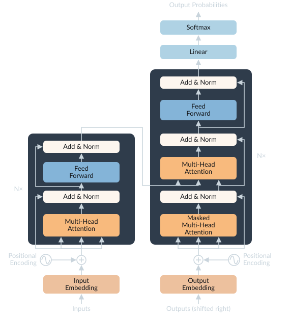

# Attention and the transformer
## The attention mechanism

Transformers are built entirely around the attention mechanism. Attention uses three inputs: Queries, Keys, and Values. A useful analogy is to how in programming we have dictionaries where you have a query (the thing you're matching against), which you compare against keys (what you have), to get values (what you want). Rather than direct equality between query and key a similarity score is computed, and rather than returning one value you return a weighted sum over all of them. Basically using a dictionary is like a hard lookup whereas attention is doing a soft lookup. From an input of $X$ we project a $Q$,$K$,and $V$ matrix.

$$
\begin{aligned}
scores &= Q \cdot K^T / \sqrt{d_k}   \\
weights &= softmax(scores) \\
attention &= weights \cdot V           
\end{aligned}
$$

This has the nice property where every token can attend any other token. I think of Query being the relevant information the token is looking for, the Key being what a token represents itself as so other tokens can find it, and the Value is the actual information handed over. Whereas before our recurrent models were bottlenecked by their iterative multiplication attention allows the model to represent relationships arbitrarily far apart (While this is true in theory we will see in practice there are constraints on how far this can go). RNNs are also bottlenecked by the amount of information they can retain in their hidden dimension, there is only so much information that can be stored in 4096 values right, as well as the backpropagation through time relying on sequential computation. 

It is worth highlighting the $\sqrt{d_k}$ normalisation in the attention calculation since to me it was not immediately obvious why we scale by the dimension axis rather than unit normalise. This proves to be a very fun and revealing rabbit hole to dig into.

I basically need to explain Source: Jamie Simon, *How to win a beer with high-dimensional statistics* (2026) — [jamiesimon.io/blog/how-to-win-a-beer-with-high-dimensional-statistics](https://jamiesimon.io/blog/how-to-win-a-beer-with-high-dimensional-statistics/)
Concentration of Measure and poly semantism 

Also need to do multi head attention at some point..

There is a distinction to be made between cross-attention (like in Bahdanau) where the queries came from the decoder and the keys/values from the encoder and self-attention. In self-attention the attention attends all on the input $X$.



## The transformer block

Continuing through the "Attention is all you need" paper, we now need to connect our attention mechanism into a machine learning model this is done with a Transformer, Attention models and transformers are used interchangeably but I think it is a useful distinction to make. A transformer starts with attention over the inputs followed by a feed forward network typically with a residual connection and some layer normalisation. 

{fig-alt="Transformer architecture: an encoder stack of multi-head attention and feed-forward layers with residual add-and-norm, feeding a decoder stack of masked attention, cross-attention and feed-forward layers, then linear and softmax."}

In the original paper the layer norm is applied to the residual but modern transformer moves the residual outside the layer norm. The motivation is you want the residual stream to represent the identity function which allows gradients to flow evenly during training. The intuition is without residual stream early into training the early layers get good updates but later layers get basically random updates. In practice this modification results in more stable training with less warm up (Xiong et al., 2020).


```python
# Original paper
X = layer_norm(X + feed_forward(X, W_1, W_2), gamma2, beta2)

# Modern 
X = X + feed_forward(layer_norm(X, gamma2, beta2), W_1, W_2)
```

## Position

There is one important piece we haven't spoken about yet, how does the model know the token position relative to each other since attention has the same score no matter what order, called permutation equivariance (work through it yourself to see if you reorder the attention calculation the score is the same). I will write a piece on position embedding and RoPE [also remember the jane street article on position embeddings]

## Training a decoder: next-token prediction

causal masking here?



Training a transformer in the pretraining phase is entirely "next-token" prediction. This is where people get the idea of LLMs as simple stochastic parrots from. Without the Supervised Fine Tuning (SFT) and Reinforcement Learning (RL) they would simply be very efficient token compression algorithms.  

To train these models we take a sequence of tokens and have the model predict the distribution of the next token. This is done by taking the model output from the final layer of the model, called logits, and taking the softmax over them to get a conditional probability distribution for the next token.

$$
\begin{aligned}
softmax(x,i) = \frac{e^{x_i}}{\sum_{j=1}^C e^{x_j}}
\end{aligned}
$$

The training objective for a transformer is the cross entropy loss between the predicted distribution and the real next token, averaged over many, many examples the model will converge on the actual distribution. A fancy way is to say in expectation the model which minimises the loss is the model which learns the true probability distributions 



So for a single example the cross entropy loss for models predicted probability distribution $p$ and target next token $y$ when we have a vocabulary of $C$ tokens.
$$
\begin{aligned}
CE = - \sum_{j=1}^C(y_{j} log(p_{j}))
\end{aligned}
$$
where $y_j = 1$ when the next token is $j$ and otherwise $y_j = 0$. Taken over some dataset of $N$ examples we get.
$$
\begin{aligned}
CE = - \frac{1}{N} \sum_{i=1}^N \sum_{j=1}^C(y_{i,j} log(p_{i,j}))
\end{aligned}
$$

## References

1. Bahdanau, D., Cho, K., & Bengio, Y. (2015). *Neural Machine Translation by Jointly Learning to Align and Translate.* arXiv:1409.0473. https://arxiv.org/abs/1409.0473

2. Vaswani, A., et al. (2017). *Attention Is All You Need.* arXiv:1706.03762. https://arxiv.org/abs/1706.03762

3. Xiong, R., et al. (2020). *On Layer Normalization in the Transformer Architecture.* arXiv:2002.04745. https://arxiv.org/abs/2002.04745

4. Bender, E. M., Gebru, T., McMillan-Major, A., & Shmitchell, S. (2021). *On the Dangers of Stochastic Parrots: Can Language Models Be Too Big?* FAccT '21. https://doi.org/10.1145/3442188.3445922
