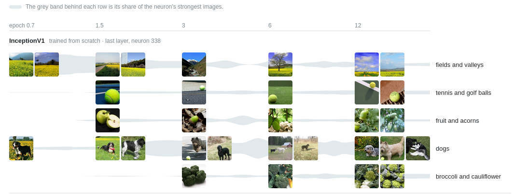
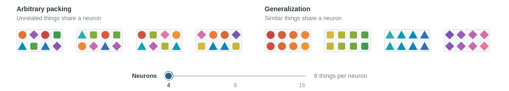

RTFP
### 1. Superposition and polysemanticity
A lot of hype around this paper, recently I read (listened) to https://arxiv.org/abs/2501.16496 which seemed much much more pessimistic around mechanistic interpretation, in particular the issue of polysemantic neurons within the neural network of the model, basically that the function of one neuron may have many different uses. The hypothesis is superposition of features, if you have some $m$ features and only $d$ orthogonal dimensions with $m \gt d$ then you're going to have to pack them in somehow. Polysemanticity is the thing we observe and superposition is the hypothesis that explains it.

By a feature I mean some concept the model uses, like "this text is in French" or "this token is a number". The neurons we're talking about live in the MLP, which reads the residual stream $x \in \mathbb{R}^{4096}$ and adds its output back on to it

$$
h = \sigma(W_{in}x + b) \quad MLP(x) = W_{out}h
$$

where each coordinate $h_n$ of $h$ is one neuron. You might ask why we talk about neurons in $h$ and not in $x$? it's because nothing in the model treats the axes of $x$ differently from any other direction, every layer just reads $x$ with a matrix multiply, so you could rotate $x$ (and the weights with it) and the model would do exactly the same thing. The axes of $x$ don't mean anything, so a feature in $x$ is just a direction. $h$ is different because $\sigma$ is applied to each coordinate on its own, e.g. in 2D a ReLU keeps the top-right quadrant and squashes everything else flat onto the axes, so the axes are now special and it makes sense to ask what each one (each neuron) responds to. Superposition still happens in $x$ and in the attention heads, but you only get polysemantic neurons in $h$.

### 2. The maths
#### Useful notation
$$
\begin{aligned}
&x \in \mathbb{R}^{d} &&\text{residual stream vector for one token} \\
&W_{in} \in \mathbb{R}^{d_{ff} \times d} &&\text{MLP input weights; row } w_n \in \mathbb{R}^{d} \text{ is neuron } n \\
&b \in \mathbb{R}^{d_{ff}} &&\text{MLP bias; } b_n \text{ is the bias of neuron } n \\
&h = \sigma(W_{in}x + b) \in \mathbb{R}^{d_{ff}} &&\text{MLP hidden activations (the neurons)} \\
&W_{out} \in \mathbb{R}^{d \times d_{ff}} &&\text{MLP output weights} \\
&\mathrm{MLP}(x) = W_{out}h \in \mathbb{R}^{d} &&\text{MLP output, added back to } x \\
&u_i \in \mathbb{R}^{d} &&\text{unit direction of feature } i \\
&U = [u_1, \dots, u_m] \in \mathbb{R}^{d \times m} &&\text{all feature directions } (m > d) \\
&a \in \mathbb{R}^{m}_{\ge 0} &&\text{feature activations (sparse)} \\
&A = W_{in}U \in \mathbb{R}^{d_{ff} \times m} &&A_{ni} = w_n \cdot u_i \text{: how much neuron } n \text{ reads feature } i \\
&v_j \in \mathbb{R}^{d_{ff}},\ c_j \ge 0 &&\text{direction and activation of MLP feature } j \ (M > d_{ff})
\end{aligned}
$$

#### 2.1 Features are directions in the residual stream
Let the model have $m$ features and $d$ dimensions, with $m \gt d$. Each feature $i$ has unit direction $u_i \in \mathbb{R}^d$ and an activation $a_i \ge 0$; most $a_i$ are $0$ so we say $a$ is sparse.
$$
x  =\sum_{i=1}^m a_iu_i
$$
The $u_i$ cannot all be orthogonal because $m > d$ by the pigeonhole principle, but they can all be **nearly** orthogonal:

In 2D, two random directions often point in similar directions. In 10,000D, there are so many directions that two random vectors are almost always at ~90°. The Johnson–Lindenstrauss theorem states you can put $n$ points into $k = O(\log n / \varepsilon^2)$ dimensions and keep all distances within a factor $1 \pm \varepsilon$, which you can invert to get $n = e^{O(\varepsilon^2 k)}$ nearly orthogonal directions in $k$ dimensions.

{fire diagram here}

The sum of many small independent effects is Gaussian. The dot product of two random unit vectors is a sum of $d$ small terms, so $u \cdot v \sim \mathcal{N}(0, 1/d)$ and the angle concentrates at 90°. A Gaussian in high dimensions is like a soap bubble: all its mass is on the surface. {this would make a nice diagram.}

#### 2.2 A neuron reads all incoming features
A neuron $n$ in an MLP computes 
$$
z_n = w_n \cdot x = \sum_{i=1}^ma_i(w_n\cdot u_i), \quad h_n = \sigma(z_n+b_n)
$$
Remember a neuron is just a row $n$ in $W_{in}$. The matrix $A = W_{in}U$, with entries $A_{ni} = w_n \cdot u_i$, tells you how much each neuron $n$ responds to feature $i$.
{another good diagram}
- Monosemantic: one large entry in row $n$ of $A$
- Polysemantic: several large entries in row $n$ of $A$

#### 2.3 Why neurons can't all be monosemantic
Suppose the MLP computes $M \gt d_{ff}$ features. Each feature is a direction $v_j$ in h-space, with activation $c_j$.
$$
h \approx \sum_{j=1}^M c_jv_j, \quad v_j \in \mathbb{R}^{d_{ff}}
$$
A coordinate of $h$ is just one entry of the vector, $h_n$, which is the output of neuron $n$, and $v_{j,n}$ is how much feature $j$ uses neuron $n$, so $h_n = \sum_{j=1}^M c_jv_{j,n}$. If every feature had its own neuron then each $v_j$ would point straight along one axis, e.g. $v_1 = (1, 0, 0, \dots)$, and each neuron would only fire for one feature. But you have $M$ features and only $d_{ff}$ neurons, so by the pigeonhole principle some features have to share. For example with 2 neurons and 3 features you could put $v_1 = (1, 0)$ and $v_2 = (0, 1)$, but $v_3$ has to go somewhere like $(0.7, 0.7)$, so now neuron 1 fires for features 1 and 3, neuron 2 fires for features 2 and 3, and both neurons are polysemantic. This is superposition in $h$, and polysemantic neurons are the result.

#### 2.4 How does superposition work
2.1–2.3 say that superposition is possible. Even if these directions are basically orthogonal I would still expect to lose information. to see why not consider reading feature $j$ back from $x$:
$$
u_j \cdot x = \underbrace{a_j}_{\text{signal}} + \underbrace{\sum_{i \ne j} a_i\,(u_i \cdot u_j)}_{\text{interference}}
$$
Example: $d = 4096$, with $k$ active features, each with $a_i = 1$.
- **Near-orthogonality:** each interference term is about $\pm 1/\sqrt{d} \approx 0.016$.
- **Sparsity:** the $k$ terms add up to a noise of about $\sqrt{k/d}$. For $k = 20$ this is about $0.07$, which is much less than the signal of $1$. If all features are active ($k = d$), the noise is about $1$ and the signal is lost.
- **ReLU with a negative bias** (for example $-0.3$): the ReLU sets the $0.07$ noise to $0$ and lets the signal through.

Near-orthogonality and sparsity keep the noise floor low. The bias sets a threshold above the noise. The ReLU outputs a value only when the input is above the threshold.

Elhage et al. (2022) show the trade-off in a toy model: dense features get their own dimensions, sparse features go into superposition.

{diagram here would be great}
### 3. Feynman explanation
I would explain the issue like this

If I want to know what a car engine can and can't do, I can take it apart, look at each piece, and write down what it does, and when I'm done I have the complete list. You'd like to do the same with a neural network, and the obvious pieces are the neurons, but when you pick one up it lights up for French, for DNA and for legal citations all at once. That's because the network knows far more things than it has neurons, so instead of giving each idea its own neuron it gives each idea its own direction, and in thousands of dimensions there's room for far more nearly-right-angled directions than there are neurons, as long as only a few ideas are switched on at once. It's like a room full of people all talking with only a handful of microphones: each microphone picks up a mix of everyone, and listening to one microphone at a time won't tell you who said what. And if you can't even say what the pieces are, you can't do the thing you took the engine apart for in the first place, which is to say for certain "nothing in here does X".
#### Other MI issues

The main tool for dealing with this is the sparse autoencoder (SAE), part of a family the paper calls sparse dictionary learning. The idea is to take the messy superposition in $x$ and unmix it into a much bigger, sparser representation, with one slot for each feature, so that each slot is something a human can read (see *Sparse Autoencoders*). The paper had two main issues with this. The first is reconstruction: if you swap the SAE's version of $x$ back into the model it gets a lot worse, e.g. GPT-4 with a 16 million feature SAE swapped in performs like a model trained with only 10% of the compute, and the error isn't random noise either, you can predict a lot of it from the input, so the SAE is systematically missing some structure the model actually uses. The second is the mapping to human concepts: the features you get depend on how big you make the dictionary and what data you train on, e.g. a "cats" feature splits into "persian", "siamese", ... as you make it bigger, and an SAE trained on pretraining data had no clean "refusal" feature while one trained on chat data did, so there isn't one fixed parts list, and the concepts the model uses don't have to line up with neat human ones. For the full list see *Open Problems in Mechanistic Interpretability*.

I think this a fair summary of the main open issues in Mechanistic Interpreatability. Lets see why we might need to be slightly less concerned now than we might have been before.

# So what is said in  Neural Networks Are Already Clean

### claims
Superposition was a bad explanation for InceptionV1, is it still an issue in other models with different data or training?
Did they retrain with residual connections and find it made the model much more interpretable?
The concepts aren't randomly overlapped but instead features become more finegrained, how is this justified and why does this happen?
https://distill.pub/2020/circuits/zoom-in/

With better tools and modern models, the situation looks quite different. In preliminary audits of Qwen3-32B, we estimate that roughly 90% of neuron poles have one main job, often with small related offshoots; another ~7% have two related jobs; and only ~2-4% are not yet understood

I would like to see "Most of the remaining apparent polysemanticity seems to be a motif I call recursive generalization"

"So two things were required. First, the neural network needed to learn well, using an architecture designed by people fully focused on that goal and with no interest in interpretability. The residual stream is one example: it was introduced to help learn deeper neural networks, and it also seems to help the deeper layers be conceptually clean, which may be related. Second, we needed tools strong enough to see them clearly."

I remember reading about how you can do optimal coding to get the entropy of a sequnce (claude shannon I think?) is there something simimlar with optimal coding like if you were storing information in a library, you would group similar information so you would have minimal movement. is there something similar where modern architecures make it easier to do this?

they make a point of modern regularisation, I need to start doing this for my own models.

I don't get it "Recursive Generalization" need to review this

I think the defineition is abit wishy wasy. We call this recursive generalization: a neuron generalizing along more than one axis, often first along one axis, then sprouting outwards in ways that are easy to follow locally, but stop it from being “monosemantic” in the end. So they are polysemantic then? He thinks this name is more appropriate than conjoined features.

The main learning principle we see everywhere is generalization. With generalization, things are put together because of a shared pattern that it’s useful to have in one place, so it can be built on. With superposition, unrelated things are placed together because they don’t interfere. These have opposite predictions: generalization should be local, superposition should be non-local, since it would want very different things to be near each other.
^^ this is quite intuitive and nice

It seems reasonable

good point that polysemantics shouldn't be the null hypothesis, how do you know your tool are not just miscalibrated.

I used to think of neurons as human-shaped nouns: one is a car, another is a curve. Now I think of them more as control flow. A neuron is less about what it sees than about what it does to the flow coming in, and often its job is to gate a region of the network. Seen this way, monosemanticity is almost the wrong question. A better one is what a neuron lets through and what it keeps ou