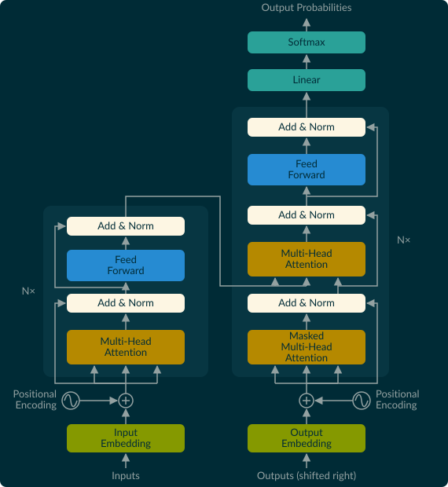

# Attention and the transformer
## The attention mechanism

Transformers are built entirely around the attention mechanism. Attention uses three inputs: Queries, Keys, and Values. A useful analogy is to how in programming we have dictionaries where you have a query (the thing you're matching against), which you compare against keys (what you have), to get values (what you want). Rather than direct equality between query and key a similarity score is computed, and rather than returning one value you return a weighted sum over all of them. Basically using a dictionary is like a hard lookup whereas attention is doing a soft lookup. From an input of $X$ we project a $Q$, $K$, and $V$ matrix.

$$
\begin{aligned}
\text{scores} &= Q K^T / \sqrt{d_k}   \\
\text{weights} &= \text{softmax}(\text{scores}) \\
\text{attention} &= \text{weights} \cdot V           
\end{aligned}
$$

This has the nice property where every token can attend to any other token. I think of Query being the relevant information the token is looking for, the Key being what a token represents itself as so other tokens can find it, and the Value is the actual information handed over. Whereas before our recurrent models were bottlenecked by their iterative multiplication attention allows the model to represent relationships arbitrarily far apart (While this is true in theory we will see in practice there are constraints on how far this can go). RNNs are also bottlenecked by the amount of information they can retain in their hidden dimension, there is only so much information that can be stored in 4096 values right, as well as the backpropagation through time relying on sequential computation. 

It is worth highlighting the $\sqrt{d_k}$ normalisation in the attention calculation since to me it was not immediately obvious why we scale by the dimension axis rather than unit normalise. Basically as the number of dimensions grows the expected value of a random dot product stays 0 but the variance scales with $d_k$.

To see why consider this non-intuitive idea: In 2D two random directions often point in similar directions. In 10,000D, there are so many directions that two random vectors are almost always at ~90°. The Johnson–Lindenstrauss theorem states you can put $n$ points into $k = O(\log n / \varepsilon^2)$ dimensions and keep all distances within a factor $1 \pm \varepsilon$, which you can invert to get $n = e^{O(\varepsilon^2 k)}$ nearly orthogonal directions in $k$ dimensions.



The sum of many small independent effects is Gaussian. The dot product of two random unit vectors is a sum of $d$ small terms, so $u \cdot v \sim \mathcal{N}(0, 1/d)$ and the angle concentrates at 90°. A Gaussian in high dimensions is like a soap bubble: all its mass is on the surface. Linking this back: when attention is not scaled the variance scales and you get problems where the softmax equation gets saturated and the gradients are either minuscule or exploding.



I love [this article](https://jamiesimon.io/blog/how-to-win-a-beer-with-high-dimensional-statistics/) (Simon, 2026) which I think demonstrates the . 

Also need to do multi head attention at some point..

There is a distinction to be made between cross-attention (like in Bahdanau) where the queries came from the decoder and the keys/values from the encoder and self-attention. In self-attention the attention attends all on the input $X$.



## The transformer block

Continuing through the "Attention is all you need" paper (Vaswani et al., 2017), we now need to connect our attention mechanism into a machine learning model this is done with a Transformer, Attention models and transformers are used interchangeably but I think it is a useful distinction to make. A transformer starts with attention over the inputs followed by a feed forward network typically with a residual connection and some layer normalisation. 

{fig-alt="Transformer architecture: an encoder stack of multi-head attention and feed-forward layers with residual add-and-norm, feeding a decoder stack of masked attention, cross-attention and feed-forward layers, then linear and softmax."}

In the original paper the layer norm is applied to the residual but modern transformers move the residual outside the layer norm. The motivation is you want the residual stream to represent the identity function which allows gradients to flow evenly during training. The intuition is without residual stream early into training the early layers get good updates but later layers get basically random updates. In practice this modification results in more stable training with less warm up (Xiong et al., 2020).


```python
# Original paper
X = layer_norm(X + feed_forward(X, W_1, W_2), gamma2, beta2)

# Modern 
X = X + feed_forward(layer_norm(X, gamma2, beta2), W_1, W_2)
```

## Position

There is one important piece we haven't spoken about yet: How does the model know the token position relative to each other? since attention has the same score no matter what order, called permutation equivariance (work through it yourself to see if you reorder the attention calculation the score is the same). The sentence "The dog bit the man" is very different from "The man bit the dog".

The way this is done is by building in a position embedding, either a learned position embedding or a constructed one. The simplest way of doing this would be to have an absolute position embedding. 

```python
# Simplest
x = token_embeddings + np.arange(seq_len)[:, None] / seq_len

#Used in GPT-2
pe = np.random.normal(size=(max_len, d_model))  # trained like any other weight
x = token_embeddings + pe[:seq_len]
```

So for each token up to our maximum sequence length we add a modification to the token embeddings which describe their absolute position in the model. The issue with this approach is it is brittle to a few things; first is the absolute nature means the model doesn't generalise well to situations where the meaning in a sequence is similar but the particular ordering could confuse the model, and the second is the model often doesn't perform well further into its context window.

What is done instead is called Rotary Position Embeddings (RoPE)

```python
def rope(x, base=10000.0):
    seq_len, d = x.shape[-2:]
    theta = base ** (-jnp.arange(0, d, 2) / d)      
    angles = jnp.arange(seq_len)[:, None] * theta   
    cos, sin = jnp.cos(angles), jnp.sin(angles)

    x1, x2 = x[..., 0::2], x[..., 1::2]              
    rotated = jnp.stack([x1 * cos - x2 * sin,
                         x1 * sin + x2 * cos], axis=-1)
    return rotated.reshape(x.shape)
```

talk through (Puranik, 2026) basically

## References

1. Bahdanau, D., Cho, K., & Bengio, Y. (2015). *Neural Machine Translation by Jointly Learning to Align and Translate.* arXiv:1409.0473. <https://arxiv.org/abs/1409.0473>

2. Vaswani, A., et al. (2017). *Attention Is All You Need.* arXiv:1706.03762. <https://arxiv.org/abs/1706.03762>

3. Xiong, R., et al. (2020). *On Layer Normalization in the Transformer Architecture.* arXiv:2002.04745. <https://arxiv.org/abs/2002.04745>

4. Simon, J. (2026). *How to Win a Beer with High-Dimensional Statistics.* <https://jamiesimon.io/blog/how-to-win-a-beer-with-high-dimensional-statistics/>

5. Puranik, A. (2026). *Using Group Theory to Explore the Space of Positional Encodings for Attention.* Jane Street Blog. <https://blog.janestreet.com/using-group-theory-to-explore-positional-encodings-attention/>
